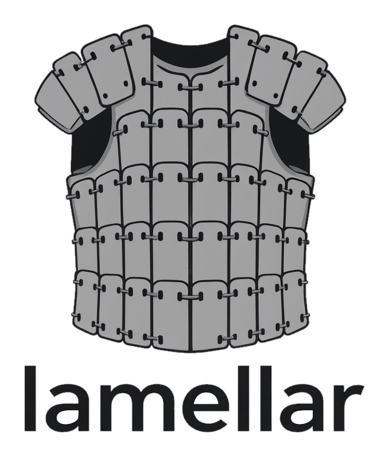
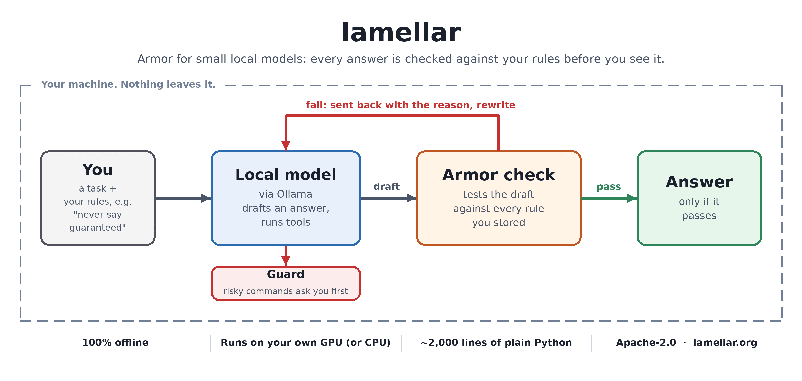
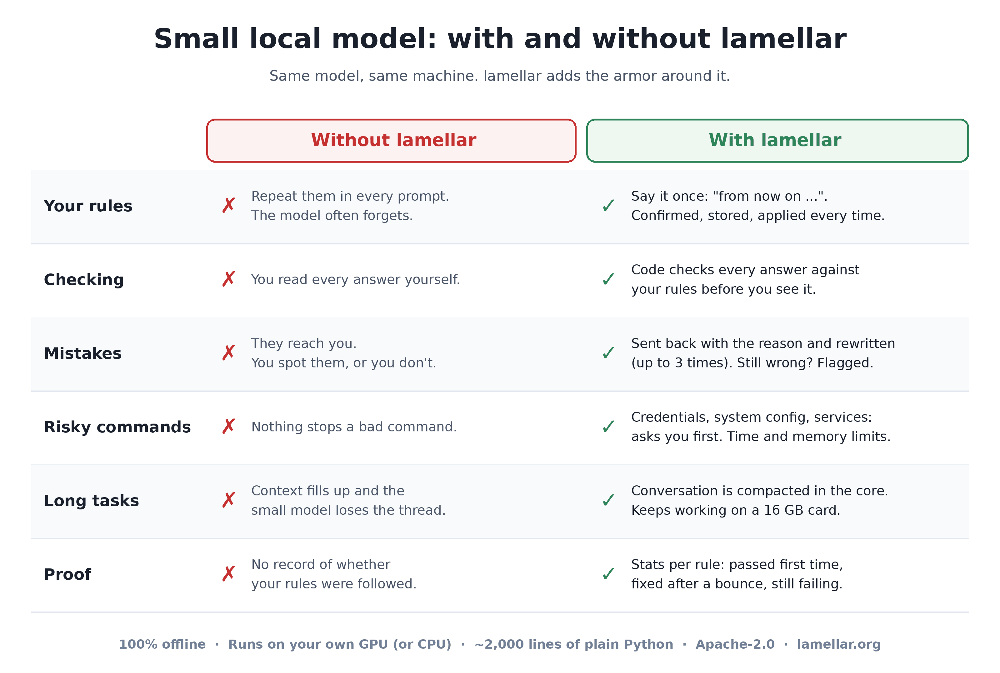

<p align="center">
  <picture>
    <source srcset="site/logo-dark.png" media="(prefers-color-scheme: dark)">
    
  </picture>
</p>

# lamellar

Armor for small local models: a small, readable, fully offline agent toolkit that checks its work before handing it to you.

Website: https://lamellar.org

Status: in development (alpha). Provided as is, with no guarantee of support.

<p align="center">
  
</p>

**How it works.** You give a task and your rules. The local model writes a draft. Before you see it, the armor checks the draft against every rule you stored. If it passes, you get the answer. If it fails, it goes back to the model with the reason and is rewritten, up to 3 times. If it still fails, you get it with a note saying which rule was missed. Risky commands stop and ask you first. All of it runs on your machine.

## Install

```
curl -fsSL https://lamellar.org/install.sh | sh        # Linux, macOS
```

No curl? `wget -qO- https://lamellar.org/install.sh | sh`. Windows is not supported yet.

Already have Ollama and a model? Name it, and nothing is downloaded or reinstalled:

```
curl -fsSL https://lamellar.org/install.sh | LAMELLAR_MODEL=qwen3.8:27b-96k sh
```

Prefer pip? It installs the same thing in two steps:

```
pip install lamellar
lamellar setup
```

Either way, it installs Ollama if needed, picks a model for your GPU, opens `http://localhost:8102/` and runs `lamellar doctor`.
Details: `docs/INSTALL.md`.

## With and without lamellar

<p align="center">
  
</p>

Same model, same machine. The difference is what happens around the model:

- **Rules are said once.** Say "from now on, never write ..." and lamellar reads the rule back to you, stores it after you confirm, and applies it to every later answer.
- **Checked by code, not by the model.** Forbidden words, required text, a length limit (in characters) and regex patterns are tested by plain code on every answer, or on the file it delivers. Rules that code cannot test (for example "sound friendly") are passed to the model as a reminder only.
- **Failures go back, not to you.** A failing answer is returned with the reason and rewritten, up to 3 times. If it still fails, it is delivered with a note saying which rule was not met.
- **Proof.** Each rule keeps a record: passed first time, fixed after a bounce, still failing.

## What it is

- **An agent that runs on your own machine.** It talks to a local model through [Ollama](https://ollama.com), runs shell commands and edits files in its working directory. Nothing leaves your computer.
- **Armor.** A lamellar is armor made of many small plates. Here the plates are rules: your requirements are stored, every answer is checked against them before delivery, and failed answers are sent back for a rewrite.
- **Guard rails.** Commands that touch credentials, system config, scheduling or services stop and ask a human first. Each command has a time and memory limit.
- **Small and readable.** About two thousand lines of Python, standard library only. Long conversations are compacted inside the core, so it keeps working on a 16 GB card.
- **A web interface included.** Open `http://localhost:8102/`, or connect Open WebUI or any OpenAI-compatible client to `/v1`.

## Which model you get

```
GPU memory       model          context
16 GB or more    qwen3.8 27B    96k
8 to 15 GB       qwen3.5 9B     32k
4 to 7 GB        qwen3.5 4B     32k
no GPU           qwen3.5 2B     16k, slow
```

Provisional; it will be replaced by measured results. Apple Silicon is picked by unified memory. Override with `... | LAMELLAR_MODEL=qwen3.5:9b sh`.

## After installing

```
lamellar start | stop | status | logs
lamellar doctor
lamellar run "summarise the CSV files in this folder"
```

## Layout

- `lamellar/core/`  loop, tools, command execution
- `lamellar/armor/`  requirements store, checks, bounce-back, guard
- `lamellar/entry/`  web interface, queueing, conversations
- `lamellar/doctor.py`  `lamellar doctor`: checks the install and says how to fix what is wrong
- `cli.py`  command-line entry point
- `EVENTS.md`  event format between the layers
- `site/`  the lamellar.org landing page

Hard rule: `core` and `armor` must not import `entry`.

Configuration uses JSON (`config.example.json`): the core supports Python 3.10, which has no built-in TOML reader, and avoids any external dependency.

## License

Apache-2.0. Copyright 2026 The lamellar Authors. See `LICENSE`.
